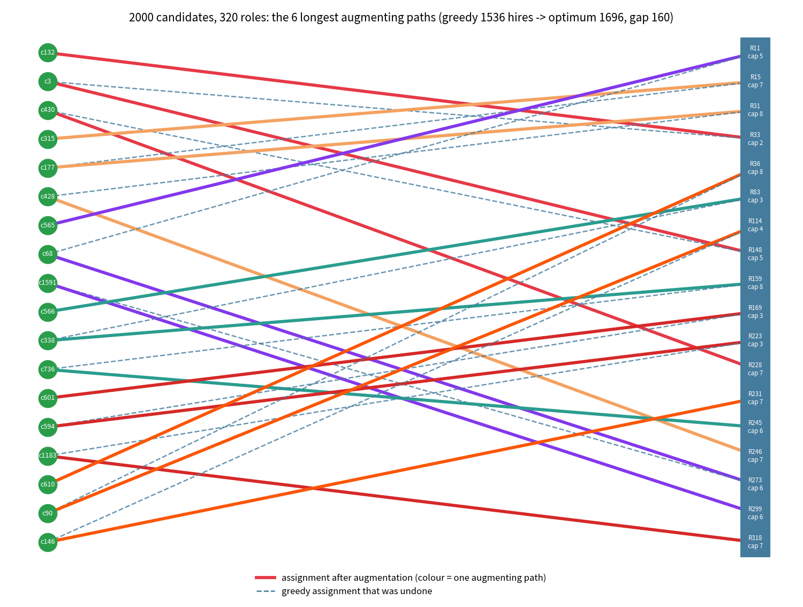
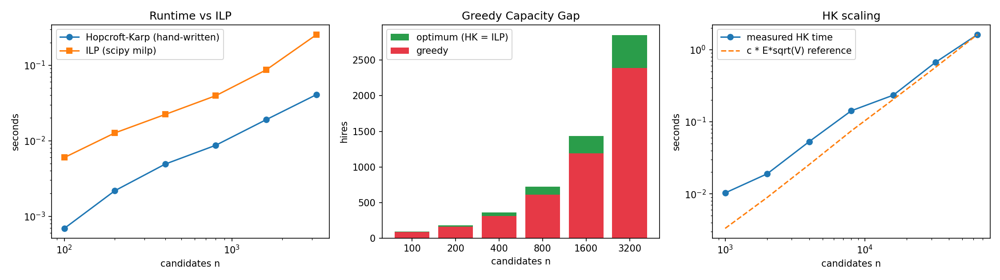

# Delta Code PS1 - Maximum Bipartite Matching via Augmenting Paths

Capacitated candidate-to-role allocation. Hand-written Hopcroft-Karp engine, optimality proof (Berge + König), and benchmark against an ILP. All numbers below are produced by `allocate.py`.


## 1. Summary of results

| Quantity | Value |
|---|---|
| Main instance | 2000 candidates, 320 roles, total capacity 1696, 49396 slot-edges |
| Greedy (first-fit) hires | 1536 |
| Hopcroft-Karp hires | 1696 |
| ILP optimum (scipy milp) | 1696 |
| Independent max-flow (networkx) | 1696 |
| Greedy Capacity Gap | 160 hires (9.4% of the optimum) |
| Scale vs problem statement | |U| = 2000 (required >= 2,000), |V| = 320 (required >= 300) |
| Augmenting paths used | 160 (found in 1 HK phase from the greedy start; mean 2.6, max 3 role changes per path) |
| Vertex-cover certificate | size 1696 = matching size 1696 |

Hopcroft-Karp, the ILP and an independent max-flow solver agree on every instance tested (the main instance and 18 benchmark instances), which doubles as a correctness check of the hand-written engine.


## 2. Model: flow network and slot expansion

Candidates u in L (|L| = n), roles j in R with capacity c_j. Eligibility edges (u, j) come from skill overlap: u is eligible for j if u covers at least 2 of the 3 skills the role requires. Build the network source -> u (cap 1), u -> j (cap 1) for eligible pairs, j -> sink (cap c_j). The value of a maximum flow equals the maximum number of hires.

**Slot expansion.** Replace each role j by c_j identical slots, each adjacent to every candidate eligible for j. A matching in this unit-capacity bipartite graph picks at most one candidate per slot, hence at most c_j candidates per role. Conversely any feasible assignment fills distinct slots of a role. So matchings in the slot graph and feasible assignments are in bijection up to renaming slots, and max matching = max flow = max hires. This lets the engine be plain Hopcroft-Karp.


## 3. Algorithms

**Greedy baseline.** Process candidates in order; each takes the first open eligible slot, irrevocably. This is the heuristic the problem statement criticises.

**Hopcroft-Karp.** Repeat until no free slot is reachable: (1) BFS from all unmatched candidates, alternating unmatched edge to a slot and matched edge back to a candidate, to get levels; stop at the first level that reaches a free slot. (2) DFS inside the level graph to find a maximal set of vertex-disjoint shortest augmenting paths and flip all of them. The DFS is iterative, so large graphs do not hit the recursion limit. The engine can warm-start from the greedy matching; every augmentation is logged, which gives the path traces in section 7.


## 4. Optimality proof

**Berge's Lemma.** A matching M in a graph is maximum if and only if it has no M-augmenting path (an alternating path that starts and ends at unmatched vertices).

**(only if)** If M has an augmenting path P, then M xor P (swap matched and unmatched edges along P) is a matching with |M| + 1 edges, because P has one more unmatched edge than matched edges and its endpoints were free. So M was not maximum.

**(if)** Suppose M is not maximum and let M' be a larger matching. Consider the symmetric difference M xor M'. Every vertex has at most one M-edge and one M'-edge, so every component is a path or an even cycle whose edges alternate between M and M'. Cycles and even-length paths contain equally many edges of each. Since |M'| > |M|, some component is a path with more M'-edges than M-edges. That path starts and ends with M'-edges, so both endpoints are M-free: it is an M-augmenting path. Hence a matching without augmenting paths is maximum. QED.

**Why Hopcroft-Karp is optimal.** It stops only when the BFS finds no free slot reachable from an unmatched candidate, i.e. when no augmenting path exists. By Berge's Lemma the matching is then maximum.

**Second certificate (min-cut / König).** After termination let Z be the set of vertices reachable from unmatched candidates by alternating paths and take C = (L minus Z) union (slots in Z). Then C covers every edge, because an uncovered edge would leave a candidate in Z with a neighbour outside Z, which is impossible. No free slot lies in Z (that would be an augmenting path), so every slot in C is matched to a candidate outside Z, and every candidate in C is matched, giving |C| = |M|. Any matching is at most any vertex cover, so M is maximum. The code checks all of this on the main instance: cover size 1696 = 1696 = matching size (0 candidates + 1696 slots).


## 5. Complexity

**Phases.** (a) Each phase strictly increases the length of the shortest augmenting path, since a maximal set of shortest paths leaves none of that length. (b) After sqrt(V) phases the shortest augmenting path has length at least sqrt(V). M xor M* (M* maximum) contains |M*| - |M| vertex-disjoint augmenting paths, each using at least sqrt(V) vertices, so at most sqrt(V) augmentations remain. Each later phase augments at least once, so at most sqrt(V) more phases. Total: O(sqrt(V)) phases.

**Cost.** One phase is one BFS plus one DFS in which every edge is advanced at most once (the `ptr` array), so O(E). Total O(E sqrt(V)) with V = n + number of slots.

**Caveat on slot expansion.** An edge to a role becomes c_j edges, so E in the slot graph can be larger than the number of eligibility pairs. A capacity-aware Dinic/Hopcroft-Karp on the original network avoids this blow-up; for these instance sizes it does not matter in practice.


## 6. Hand-traceable example (6 candidates, 4 roles)

Capacities: R1 = 1, R2 = 1, R3 = 1, R4 = 3. Eligibility: c1 -> R1, R2; c2 -> R1; c3 -> R2, R3; c4 -> R3, R4; c5 -> R4; c6 -> R4.

| Candidate | c1 | c2 | c3 | c4 | c5 | c6 |
|---|---|---|---|---|---|---|
| Greedy | R1 | unmatched | R2 | R3 | R4 | R4 |
| Optimal | R2 | R1 | R3 | R4 | R4 | R4 |

Greedy hires 5: c1 takes R1 first, which blocks c2 (whose only option is R1). The augmenting path from c2 is  c2 -> R1 (held by c1) -> c1 moves to R2 (held by c3) -> c3 moves to R3 (held by c4) -> c4 moves to R4 (free). Flipping it hires 6, which equals the ILP optimum (6). Trace from the engine: path 1 (+1 hire, 4 role change(s)): c2: unmatched -> R1;  c1: R1 -> R2;  c3: R2 -> R3;  c4: R3 -> R4


## 7. Main instance: how greedy mistakes were undone



*The 6 longest augmenting paths of the main instance (drawing all 2,000 candidates would be unreadable). Each colour is one path; dashed blue lines are the greedy assignments that were undone.*

Greedy hires 1536; the engine then finds 160 augmenting paths and hires 1696. A path is a chain of reassignments: the first candidate takes a role, displacing someone who moves on, until the chain ends at a role with a free slot. Paths have 2.6 role changes on average (longest: 3). The 8 longest traces (candidate: old role -> new role); all of them are in `path_traces.txt`:

- path 1 (+1 hire, 3 role change(s)): c132: unmatched -> R33;  c3: R33 -> R148;  c430: R148 -> R228
- path 2 (+1 hire, 3 role change(s)): c315: unmatched -> R15;  c177: R15 -> R31;  c428: R31 -> R246
- path 3 (+1 hire, 3 role change(s)): c565: unmatched -> R11;  c68: R11 -> R273;  c1591: R273 -> R299
- path 4 (+1 hire, 3 role change(s)): c566: unmatched -> R83;  c338: R83 -> R159;  c736: R159 -> R245
- path 5 (+1 hire, 3 role change(s)): c601: unmatched -> R169;  c594: R169 -> R223;  c1183: R223 -> R318
- path 6 (+1 hire, 3 role change(s)): c610: unmatched -> R36;  c90: R36 -> R114;  c146: R114 -> R231
- path 7 (+1 hire, 3 role change(s)): c642: unmatched -> R33;  c10: R33 -> R148;  c680: R148 -> R287
- path 8 (+1 hire, 3 role change(s)): c647: unmatched -> R41;  c72: R41 -> R211;  c1724: R211 -> R249

After the last path, 304 candidates remain unassigned and 320 of 320 roles are full (total capacity 1696). The vertex cover above certifies that no larger matching exists.


## 8. Benchmark against ILP and scaling

Instances: n candidates, n/8 roles, each candidate eligible for 1 to 6 roles drawn with skewed popularity, total capacity 0.9 n. Values are averages over 3 random instances. ILP: maximise sum x_uj s.t. sum_j x_uj <= 1, sum_u x_uj <= c_j, x binary (scipy.optimize.milp).

| n | greedy | optimum (HK = ILP) | gap | gap % | HK time (s) | ILP time (s) | ILP / HK |
|---|---|---|---|---|---|---|---|
| 100 | 82.7 | 89.3 | 6.7 | 7.5% | 0.0008 | 0.0072 | 8.8x |
| 200 | 157.3 | 181.3 | 24.0 | 13.2% | 0.0024 | 0.0167 | 7.1x |
| 400 | 309.3 | 358.7 | 49.3 | 13.8% | 0.0057 | 0.0323 | 5.7x |
| 800 | 610.0 | 719.7 | 109.7 | 15.2% | 0.0128 | 0.0554 | 4.3x |
| 1600 | 1192.7 | 1433.0 | 240.3 | 16.8% | 0.0289 | 0.1239 | 4.3x |
| 3200 | 2392.0 | 2853.3 | 461.3 | 16.2% | 0.0602 | 0.3862 | 6.4x |



*Left: runtime vs ILP. Middle: greedy vs optimal hires. Right: HK-only scaling against a c*E*sqrt(V) reference.*

HK matched the ILP optimum on all 18 benchmark instances. The greedy gap ranges from 7.5% to 16.8% of the optimum and generally grows with instance size. Scaling run (HK only): n from 1000 to 64000 (64x) took the edge count from 26,131 to 1,597,031 (61x) and the time from 0.018s to 2.181s (120x), with only 3 to 5 phases. Runtime therefore grows roughly with E, slightly super-linearly, comfortably within the E*sqrt(V) bound; the sqrt(V) phase bound is a worst case that these instances do not approach.


## 9. Greedy Capacity Gap

Define Gap = |M_HK| - |M_greedy|, the number of hires that irrevocable first-fit loses relative to the optimum (also reported as a percentage of the optimum). Main instance: 160 hires (9.4%). Benchmarks: see table above.


## 10. Limitations and honesty notes

- The problem statement says "real data" but supplies no dataset, so all data here is synthetic. The main instance uses a fixed seed (1) chosen in advance, not selected for its gap.
- Eligibility is a simple skill-overlap rule. It is a stand-in for a real recommender and does not affect the matching theory.
- Greedy depends on candidate order; first-fit in index order is used, as in the problem statement.
- Runtimes are from a single machine and Python; they show trends, not absolute performance.


## 11. How to reproduce

```bash
pip install -r requirements.txt
python allocate.py      # csv files, PNG plots, results.json
python make_report.py   # report.md and presentation.pdf
```
